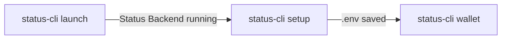

# CLI

Status command-line interface is built for agentic AI applications. `status-cli` is installed together with the SDK:

```
pip install status-sdk
```

To set up the repository in editable mode so changes are picked up without reinstalling:

```
pip install -e .
```

Verify that it is available:

```
status-cli --help
```

Every command and group has its own `--help`, listing its arguments and options with their defaults.

## How it works



1. [`launch`](./cli.md#status-cli-launch) - start Status Backend, in Docker or from a prebuilt release. You can skip this if you already have Status Backend running.
2. [`setup`](./cli.md#status-cli-setup) - save the account login and connection details once.
3. [`wallet`](./cli.md#status-cli-wallet) - every other command logs in with the saved details on its own.

### Saved details

Each `status-cli` call is a separate process, so nothing is kept in memory between two commands. Instead, [`setup`](./cli.md#status-cli-setup) saves everything needed to log in into a `.env` file, and every command that needs an account reads it.

The `.env` file lives in the CLI's app folder:

| OS | Folder |
|-----|-----|
| Mac | `~/Library/Application Support/status-sdk` |
| Linux | `~/.config/status-sdk` |
| Windows | `%APPDATA%\status-sdk` |

The `.env` file holds your password and mnemonic in plain text. It is created readable and writable **only by your user**. Do not commit it or share it.

## Commands

### `status-cli launch`

Start Status Backend. Choose **one** of the two subcommands.

| | [`launch docker`](./cli.md#status-cli-launch-docker) | [`launch download`](./cli.md#status-cli-launch-download) |
|---|---|---|
| Needs | Docker (and WSL on Windows) | Nothing - a prebuilt release is downloaded |
| Backend runs as | A container in the background | A process attached to the terminal |
| Stopping it | `docker stop status-backend` | `Ctrl+C` |


#### `status-cli launch docker`

Build and run Status Backend in a Docker container using [`launch_docker_container`](./utils.md#launch_docker_containercommitnone-wait_seconds5-platformlinuxamd64-data_foldernone). **The container keeps running in the background.**

| Name | Type | Required | Description |
|-----|-----|-----|-------------|
| `--commit` | `str` | No | The `status-im/status-go` commit SHA, branch or tag to build. Defaults to the newest commit. |
| `--platform` | `str` | No | The platform the image is built for. Defaults to `linux/amd64`. Run `docker buildx ls` to see the platforms your Docker installation supports. |
| `--wait-seconds` | `int` | No | Seconds to wait for Status Backend to boot after the container starts. Defaults to `5`. |
| `--data-folder` | `str` | No | Local folder holding the account data. Needed for [Community Control Nodes](./community.md#control-node). |

```
status-cli launch docker
```

Build a specific commit for a Raspberry PI 5:

```
status-cli launch docker --commit 2bee8b6a38cdc8f92d74e2dbb8c4e77fbbeea149 --platform linux/arm64
```

**Note**: The first build takes a while, as `status-go` is built from source. The same Docker requirements apply as for [`launch_docker_container`](./utils.md#launch_docker_containercommitnone-wait_seconds5-platformlinuxamd64-data_foldernone) - see [Windows](./utils.md#windows), [Mac](./utils.md#mac) and [Linux](./utils.md#linux).

#### `status-cli launch download`

Download a prebuilt Status Backend release from GitHub and run it using [`download_build_and_launch`](./utils.md#download_build_and_launchlaunchernone-repo_namestatus-imstatus-go-tagnone-tokennone-addresslocalhost8080-wait_seconds30). The command **stays in the foreground** while Status Backend runs - press `Ctrl+C` to stop both. Other commands must be ran from a second terminal.

| Name | Type | Required | Description |
|-----|-----|-----|-------------|
| `--tag` | `str` | No | The release tag. Defaults to the latest release. |
| `--token` | `str` | No | A GitHub token. Required for private repositories. |
| `--launcher` | `str` | No | Path to a `status-backend` binary that is already on disk. When given, nothing is downloaded. |
| `--host` | `str` | No | The host to run Status Backend on. Defaults to `localhost`. |
| `--port` | `int` | No | The port to run Status Backend on. Defaults to `8080`. |
| `--wait-seconds` | `int` | No | Seconds to wait for Status Backend to answer after it starts. Downloading is not subject to this timeout. Defaults to `30`. |
| `--folder` | `str` | No | Where the release is downloaded to and Status Backend runs from. Defaults to the [app folder](./cli.md#saved-details), so the release is downloaded once and reused. |

```
status-cli launch download
```

Run a specific release on a different port:

```
status-cli launch download --port 9500
```

**Note**: If you change `--host` or `--port`, run [`setup`](./cli.md#status-cli-setup) with the matching `--domain` and `--backend-port`, so the other commands connect to the right place.

### `status-cli setup`

Save the account login and the [`Account`](./account.md#accountdomainlocalhost-backend_port8080-media_port9000-is_securefalse-backup_foldernone-volume_foldernone-show_logstrue) connection details to the [`.env` file](./cli.md#saved-details). Run it **once** before any  command, and again whenever a value needs to change.

Nothing is logged in during `setup` - the details are only saved. The account is logged in (or created) by the first command that needs it:

- If no account with `--name` exists, a **new account is created** with the given password.
- If `--mnemonic` is also given, the account is **recovered** instead.
- If the account already exists, it is logged in.

Every value can be given as an option, or through its environment variable. Values that are not given are asked for interactively.

| Name | Env variable | Type | Default | Description |
|-----|-----|-----|-----|-------------|
| `--name` | `LOGIN_NAME` | `str` | `status-bot-67` | Your [display name](./account.md#display-name) or ENS. |
| `--password` | `LOGIN_PASSWORD` | `str` | Generated | Your account password. |
| `--generate-password` | | flag | | Generate a new password, replacing the saved one. Cannot be used together with `--password`. |
| `--mnemonic` | `LOGIN_MNEMONIC` | `str` | | The mnemonic to [recover an account](./account.md#recover-account) with. |
| `--infura-token` | `LOGIN_INFURA_TOKEN` | `str` | | [Infura](https://www.infura.io/) token for [wallet access](./account.md#wallet-setup). |
| `--alchemy-token` | `LOGIN_ALCHEMY_TOKEN` | `str` | | [Alchemy](https://alchemy.com/) token for [wallet access](./account.md#wallet-setup). |
| `--coingecko-api-key` | `LOGIN_COINGECKO_API_KEY` | `str` | | [CoinGecko](https://www.coingecko.com/) API key for [wallet access](./account.md#wallet-setup). |
| `--domain` | `ACCOUNT_DOMAIN` | `str` | `localhost` | Domain where Status Backend is reachable. Use the container name when running inside the same Docker network. |
| `--backend-port` | `ACCOUNT_BACKEND_PORT` | `int` | `8080` | Port exposed by Status Backend. |
| `--media-port` | `ACCOUNT_MEDIA_PORT` | `int` | `9000` | Port exposed by the Status media server, used for images. |
| `--is-secure` | `ACCOUNT_IS_SECURE` | `bool` | `false` | Use `https` instead of `http`. Accepts `true` / `false`, `yes` / `no` or `1` / `0`. |
| `--backup-folder` | `ACCOUNT_BACKUP_FOLDER` | `str` | SDK's own | An existing folder where [backups](./account.md#backups) are created and loaded from. |
| `--volume-folder` | `ACCOUNT_VOLUME_FOLDER` | `str` | SDK's own | An existing folder holding the `docker-compose.yaml` used to launch Status Backend. |
| `--no-input` | | flag | | Skip user terminal prompts and store the passed values directly. |

**Note**: Wallet access needs **all three** of `--infura-token`, `--alchemy-token` and `--coingecko-api-key`, the same as [`login`](./account.md#wallet-setup). Giving only some of them is rejected.

#### Interactively

Run it without options and answer the prompts.

```
status-cli setup
```

- **Password** - leave it blank to generate a strong one, or type your own and repeat it to confirm. A generated password is only saved in the `.env` file and never printed.
- If a value already exists you are asked whether to overwrite it or keep the saved value.

```
LOGIN_NAME (alice) is already set. Overwrite it? [y/N]:
```

#### With options

Values given as options (or env variables) are saved **without asking**, and replace the saved ones. Only the values that were not given are prompted for:

```
status-cli setup --name alice --backend-port 9500
```

#### For AI agents

Always pass `--no-input` so `setup` never waits on a prompt. Values that are not given keep their saved value, or use their default, and a password is generated when none is saved. Pass the password, mnemonic and wallet tokens as env variables only - never as options - so they stay out of the process list and your transcript:

```
LOGIN_PASSWORD="my-password" status-cli setup --name alice --no-input
```

Enable wallet access:

```
LOGIN_INFURA_TOKEN="..." LOGIN_ALCHEMY_TOKEN="..." LOGIN_COINGECKO_API_KEY="..." status-cli setup --no-input
```

The `.env` file is only written once every value is valid. If `setup` fails - for example, the passwords do not match or a folder does not exist - the saved details are left untouched.

### `status-cli wallet`

Work with the wallet of the [saved account](./cli.md#status-cli-setup). Every `wallet` command needs Status Backend running - see [`launch`](./cli.md#status-cli-launch). Every command **except** the bare `wallet` command below also needs [`setup`](./cli.md#status-cli-setup) run with all three wallet tokens.

Running `wallet` on its own, with no subcommand, prints your wallet address:

```
status-cli wallet
```

#### Active chains

Every chain ID given to a `wallet` command must be **currently active** in the wallet - see [`selected_chains`](./wallet.md#selected_chains). Check which chains are active with [`wallet chains`](./cli.md#status-cli-wallet-chains), and turn one on with [`wallet chains activate`](./cli.md#status-cli-wallet-chains-activate-chain_ids). Up to 5 `Mainnet` and 5 `Testnet` chains can be active at the same time.

A chain that is not active is rejected before anything runs, and the error lists the chains that are:

```
Error: Invalid value for '--chain': Chain 137 not active. Active chains: 1 (Ethereum), 8453 (Base)
```

#### `status-cli wallet balance`

Print the tokens in your wallet with their amount, fiat value and market data, as a table, using [`[fiat_currency]`](./wallet.md#fiat_currency) and [`get_current_market_info`](./wallet.md#get_current_market_infotoken_addresses-chain_ids1-ccyusd). Covers every chain the wallet holds tokens on.

| Name | Type | Required | Description |
|-----|-----|-----|-------------|
| `--ccy` | `str` | No | The [ISO 4217](https://en.wikipedia.org/wiki/ISO_4217) fiat currency code to value the tokens in. Defaults to `USD`. |

```
status-cli wallet balance
```

Value the tokens in euro:

```
status-cli wallet balance --ccy GBP
```

#### `status-cli wallet chains`

Print the chains that are currently **active** in the wallet as a table, using [`selected_chains`](./wallet.md#selected_chains). Only these chains can be used by the other `wallet` commands - see [Active chains](./cli.md#active-chains).

```
status-cli wallet chains
```

#### `status-cli wallet chains activate CHAIN_IDS...`

Activate one or more chains so the wallet can use them. Prints one line per chain that was activated.

| Name | Type | Required | Description |
|-----|-----|-----|-------------|
| `CHAIN_IDS` | `int` | Yes | One or more chain IDs to activate, separated by spaces. |

```
status-cli wallet chains activate 10 137
```

```
Activated 10 (Optimism)
Activated 137 (Polygon)
```

#### `status-cli wallet chains deactivate CHAIN_IDS...`

Deactivate one or more chains so the wallet stops using them. Prints one line per chain that was deactivated.

| Name | Type | Required | Description |
|-----|-----|-----|-------------|
| `CHAIN_IDS` | `int` | Yes | One or more active chain IDs to deactivate, separated by spaces. |

```
status-cli wallet chains deactivate 10
```

```
Deactivated 10 (Optimism)
```

#### `status-cli wallet search WALLET_ADDRESS TOKENS...`

Look up the balance of one or more tokens for **any** wallet address. The wallet does not need to belong to your account. Prints the balance of each token, its fiat value and the total.

| Name | Type | Required | Description |
|-----|-----|-----|-------------|
| `WALLET_ADDRESS` | `str` | Yes | The wallet address to look up - `0x` followed by 40 hex characters. |
| `TOKENS` | `str` | Yes | One or more token symbols such as `ETH` or `USDC`, or the tokens' contract addresses, separated by spaces. |
| `--chain` | `int` | No | The [active](./cli.md#active-chains) chain ID where the tokens exist. Defaults to `1` (Ethereum). |
| `--ccy` | `str` | No | The [ISO 4217](https://en.wikipedia.org/wiki/ISO_4217) fiat currency code to value the tokens in. Defaults to `USD`. |

```
status-cli wallet search 0x1234567890abcdef1234567890abcdef12345678 ETH USDC
```

Look up USDC on Base in euro:

```
status-cli wallet search 0x1234567890abcdef1234567890abcdef12345678 USDC --chain 8453 --ccy EUR
```

The output has three sections, each followed by a line of `=`:

```
Search Results:

| timestamp | wallet_address | token_address | token_symbol | amount | chain_id | ccy | price | fiat_value | total |
|...

Total:
1234.56 USD

Chain Total:

|   chain_id |   total |
|...
```

#### `status-cli wallet transactions`

Print the transaction history of your wallet, or of any other wallet addresses, as a table using. Transactions are sorted from newest to oldest.

| Name | Type | Required | Description |
|-----|-----|-----|-------------|
| `--address` | `str` | No | A wallet address to get the history for - `0x` followed by 40 hex characters. Repeat it for several wallets. Defaults to your own wallet. |
| `--chain` | `int` | No | An [active](./cli.md#active-chains) `Mainnet` chain ID to get the history for. Repeat it for several chains. Defaults to every active `Mainnet` chain. |

```
status-cli wallet transactions
```

The history of another wallet on Ethereum and Optimism:

```
status-cli wallet transactions --address 0xd8dA6BF26964aF9D7eEd9e03E53415D37aA96045 --chain 1 --chain 10
```

#### `status-cli wallet send ADDRESS AMOUNT SYMBOL`

Send `AMOUNT` of `SYMBOL` to the wallet `ADDRESS`. Prints the transaction hash.

| Name | Type | Required | Description |
|-----|-----|-----|-------------|
| `ADDRESS` | `str` | Yes | The wallet address of the receiver - `0x` followed by 40 hex characters. |
| `AMOUNT` | `float` | Yes | The amount of `SYMBOL` to send. Must be greater than `0`. |
| `SYMBOL` | `str` | Yes | A token symbol such as `ETH` or `USDC`, or the token's contract address. |
| `--chain` | `int` | No | The [active](./cli.md#active-chains) chain ID to send on. Defaults to `1` (Ethereum). |

```
status-cli wallet send 0x1234567890abcdef1234567890abcdef12345678 0.01 ETH
```

Send USDC on Base:

```
status-cli wallet send 0x1234567890abcdef1234567890abcdef12345678 25 USDC --chain 8453
```

```
0x...
```

**Note**: Transactions **cannot be undone** and the command does not ask for confirmation. Double check `ADDRESS`, `AMOUNT` and `--chain` before running it. The sender and receiver must be on the **same chain**.

#### `status-cli wallet swap FROM_TOKEN TO_TOKEN AMOUNT`

Swap `AMOUNT` of `FROM_TOKEN` to `TO_TOKEN` on one chain or across two. Prints the transaction hash on `--from-chain`.

| Name | Type | Required | Description |
|-----|-----|-----|-------------|
| `FROM_TOKEN` | `str` | Yes | The token to swap from. A symbol such as `ETH` or `USDC`, or the token's contract address. |
| `TO_TOKEN` | `str` | Yes | The token to swap to. A symbol such as `ETH` or `USDC`, or the token's contract address. Must be different from `FROM_TOKEN` when both are on the same chain. |
| `AMOUNT` | `float` | Yes | The amount of `FROM_TOKEN` to swap. Must be greater than `0`. |
| `--from-chain` | `int` | No | The [active](./cli.md#active-chains) chain ID where `FROM_TOKEN` is. Defaults to `1` (Ethereum). |
| `--to-chain` | `int` | No | The [active](./cli.md#active-chains) chain ID where `TO_TOKEN` arrives. Defaults to `--from-chain`, so the swap stays on one chain. |

Swap ETH to USDC on Base:

```
status-cli wallet swap ETH USDC 0.05 --from-chain 8453
```

Swap ETH on Ethereum to SNT on Base:

```
status-cli wallet swap ETH SNT 0.01 --from-chain 1 --to-chain 8453
```

Move ETH from Ethereum to Base:

```
status-cli wallet swap ETH ETH 0.01 --from-chain 1 --to-chain 8453
```

**Note**: Swaps **cannot be undone** and the command does not ask for confirmation. If Status Backend cannot find a route for the swap, the command fails with the reason, and nothing is swapped. For a swap across chains, the funds arrive on `--to-chain` some time after the hash is printed.

#### `status-cli wallet address`

Print every saved address in the wallet. Saved addresses let you keep a name next to a wallet address.

```
status-cli wallet address
```

Each saved address is printed with its name, ENS name and when it was saved, followed by a line of `=`:

```
Address: 0xd8da6bf26964af9d7eed9e03e53415d37aa96045
Name: Vitalik
Ens: vitalik.eth
Created At: 2026-10-23 14:03:51

====================...
```

If nothing is saved, `No saved addresses found.` is printed.

#### `status-cli wallet address save ADDRESS NAME`

Save a wallet address under a name. Prints `Added <ADDRESS>`.

| Name | Type | Required | Description |
|-----|-----|-----|-------------|
| `ADDRESS` | `str` | Yes | The wallet address to save - `0x` followed by 40 hex characters. It is stored lowercased. |
| `NAME` | `str` | Yes | The name to save the address under. Letters, numbers, `_` and `-`, with single spaces between words, up to 24 characters - see the [naming rules](./saved-address.md#name). Quote a name that has spaces. |
| `--ens` | `str` | No | The [ENS name](https://status.app/help/profile/transfer-your-ens-name-to-status) of the address. |

```
status-cli wallet address save 0xd8dA6BF26964aF9D7eEd9e03E53415D37aA96045 Vitalik
```

Save an address with a name that has spaces, and its ENS name:

```
status-cli wallet address save 0x50c24a2538561d9fea3bcbeb1f909618aaaba7cc "Jonathan Rain" --ens jonathanrain.stateofus.eth
```

An address can only be saved once. To change the name or ENS name of a saved address, use [`edit`](./cli.md#status-cli-wallet-address-edit-address).

#### `status-cli wallet address edit ADDRESS`

Change the name or ENS name of a saved address. Prints `Edited <ADDRESS>`.

| Name | Type | Required | Description |
|-----|-----|-----|-------------|
| `ADDRESS` | `str` | Yes | The saved wallet address to edit - `0x` followed by 40 hex characters. Either casing works. |
| `--name` | `str` | No | The new name for the address. Must follow the same [naming rules](./saved-address.md#name) as `save`. |
| `--ens` | `str` | No | The new ENS name of the address. |

Pass `--name`, `--ens` or both. Calling `edit` with neither fails. The command also fails if `ADDRESS` is not saved, or if the new name breaks the naming rules.

Rename a saved address:

```
status-cli wallet address edit 0xd8dA6BF26964aF9D7eEd9e03E53415D37aA96045 --name "Vitalik Buterin"
```

Change both the name and the ENS name:

```
status-cli wallet address edit 0xd8dA6BF26964aF9D7eEd9e03E53415D37aA96045 --name Vitalik --ens vitalik.eth
```

#### `status-cli wallet address delete ADDRESSES...`

Delete one or more saved addresses, using [`delete`](./saved-address.md#delete). Prints `Deleted <ADDRESS>` for each address that was deleted.

| Name | Type | Required | Description |
|-----|-----|-----|-------------|
| `ADDRESSES` | `str` | Yes | One or more saved wallet addresses to delete, separated by spaces. Either casing works. |

```
status-cli wallet address delete 0xd8dA6BF26964aF9D7eEd9e03E53415D37aA96045
```

Delete several saved addresses at once:

```
status-cli wallet address delete 0xd8dA6BF26964aF9D7eEd9e03E53415D37aA96045 0x50c24a2538561d9fea3bcbeb1f909618aaaba7cc
```
