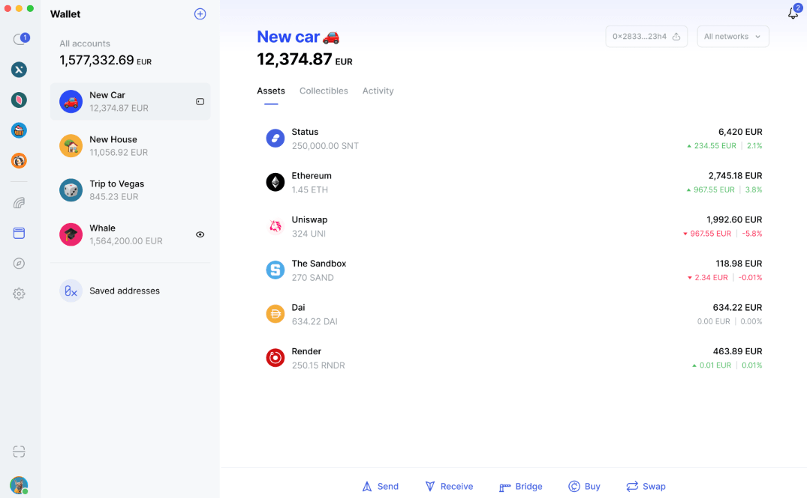

# Wallet


Wallet features are optional and can be omitted if not required for your use case. They provide functionality equivalent to the **Wallet** and **Market** tabs.



Wallet functionality is accessed through the [`wallet`](./account.md#wallet) property on a logged-in [`Account`](./account.md), which returns a `Wallet` instance:

```python
from status_sdk import Account

account = Account()
params = {
    "name": "status-app-bot",
    "password": "SNTPUMP",
    "infura_token": "token from https://www.infura.io/",
    "alchemy_token": "token from https://www.alchemy.com/",
    "coingecko_api_key": "API key from https://www.coingecko.com/"
}
account.login(**params)

wallet = account.wallet
```

`infura_token`, `alchemy_token` and `coingecko_api_key` must **all** be provided to [`login`](./account.md#loginpassword-key_uidnone-namenone-mnemonicnone-infura_tokennone-alchemy_tokennone-coingecko_api_keynone) for `account.wallet` to work. If any is missing, accessing the property raises `WalletNotConfiguredError`.

## Methods

### `get_current_balance()`

Get the account's current balance across all supported chains.

Returns `pd.DataFrame` containing only **non-zero** balances.

| Column | Type | Description |
|--------|------|-------------|
| `timestamp` | `datetime.datetime` | Timestamp when the balance was fetched. |
| `address` | `str` | Token contract address. |
| `chain_id` | `int` | Chain ID where the token exists. |
| `amount` | `float` | Token balance (adjusted using token decimals). |
| `symbol` | `str` | Token symbol (e.g. `ETH`, `USDT`). |

```python
from status_sdk import Account

account = Account()

params = {
    "name": "status-app-bot",
    "password": "SNTPUMP",
    "infura_token": "token from https://www.infura.io/",
    "alchemy_token": "token from https://www.alchemy.com/",
    "coingecko_api_key": "API key from https://www.coingecko.com/"
}
account.login(**params)
print(account.wallet.get_current_balance())
```

### `search(token_addresses, chain_ids=1, wallets=None, ccy=None)`

Get the current amount for the given token addresses, chain IDs and wallets. Unlike [`get_current_balance`](./wallet.md#get_current_balance), this can look up **any** wallet - not just the logged-in account's - and supports querying multiple tokens, chains and wallets at once. Balances are adjusted using token decimals, and can optionally be converted into one or more fiat currencies.

| Name | Type | Required | Description |
|-----|-----|-----|-------------|
| `token_addresses` | `list[str]`<br>`str` | Yes | Token address(es) as they appear in [`available_tokens`](./wallet.md#available_tokens). |
| `chain_ids` | `list[int]`<br>`int` | No | Chain ID(s) as they appear in [`available_chains`](./wallet.md#available_chains). Defaults to `1` (Ethereum mainnet). |
| `wallets` | `list[str]`<br>`str` | No | Wallet address(es) to look up. Defaults to the logged-in account's own wallet address. |
| `ccy` | `list[str]`<br>`str` | No | [ISO 4217](https://www.iso.org/iso-4217-currency-codes.html) fiat currency code(s) to convert the balance into. When omitted, no fiat conversion is done. |

Returns `pd.DataFrame`.

| Column | Type | Description |
|--------|------|-------------|
| `timestamp` | `datetime.datetime` | Timestamp when the balance was fetched. |
| `wallet_address` | `str` | Wallet address for which the balance was retrieved. |
| `token_address` | `str` | Token contract address. |
| `token_symbol` | `str` | Token symbol (e.g. `ETH`, `USDT`). |
| `amount` | `float` | Token balance (adjusted using token decimals). |
| `chain_id` | `int` | Chain ID where the token exists. |
| `ccy` | `str` | Fiat currency (only present if `ccy` is provided). |
| `price` | `float` | Token price **for 1 `token_symbol`** in the given fiat currency (only present if `ccy` is provided). |
| `fiat_value` | `float` | `amount * price` - the wallet's holding of the token, in the given fiat currency (only present if `ccy` is provided). |

```python
from status_sdk import Account

account = Account()

params = {
    "name": "status-app-bot",
    "password": "SNTPUMP",
    "infura_token": "token from https://www.infura.io/",
    "alchemy_token": "token from https://www.alchemy.com/",
    "coingecko_api_key": "API key from https://www.coingecko.com/"
}
account.login(**params)

token_mapping = {
    'ETH': '0x0000000000000000000000000000000000000000',
    'SNT': '0x744d70fdbe2ba4cf95131626614a1763df805b9e',
    'USDT': '0xdac17f958d2ee523a2206206994597c13d831ec7',
    'CELO': '0x9b88d293b7a791e40d36a39765ffd5a1b9b5c349'
}
token_addresses = list(token_mapping.values())
# Returns data for logged in wallet
data = account.wallet.search(token_addresses)
```

Access multiple chains:

```python
from status_sdk import Account

account = Account()

params = {
    "name": "status-app-bot",
    "password": "SNTPUMP",
    "infura_token": "token from https://www.infura.io/",
    "alchemy_token": "token from https://www.alchemy.com/",
    "coingecko_api_key": "API key from https://www.coingecko.com/"
}
account.login(**params)

token_mapping = {
    'ETH': '0x0000000000000000000000000000000000000000',
    'SNT': '0x744d70fdbe2ba4cf95131626614a1763df805b9e',
    'USDT': '0xdac17f958d2ee523a2206206994597c13d831ec7',
    'CELO': '0x9b88d293b7a791e40d36a39765ffd5a1b9b5c349'
}
token_addresses = list(token_mapping.values())
chain_ids = [1, 10] # Can be a single int value as well
# Returns data for logged in wallet
data = account.wallet.search(token_addresses, chain_ids)
```

Access multiple wallets:

```python
from status_sdk import Account

account = Account()

params = {
    "name": "status-app-bot",
    "password": "SNTPUMP",
    "infura_token": "token from https://www.infura.io/",
    "alchemy_token": "token from https://www.alchemy.com/",
    "coingecko_api_key": "API key from https://www.coingecko.com/"
}
account.login(**params)

token_mapping = {
    'ETH': '0x0000000000000000000000000000000000000000',
    'SNT': '0x744d70fdbe2ba4cf95131626614a1763df805b9e',
    'USDT': '0xdac17f958d2ee523a2206206994597c13d831ec7',
    'CELO': '0x9b88d293b7a791e40d36a39765ffd5a1b9b5c349'
}
token_addresses = list(token_mapping.values())
chain_ids = [1, 10] # Can be a single int value as well

vitalik_address = "0xd8dA6BF26964aF9D7eEd9e03E53415D37aA96045"
bot_wallet = account.info["wallet_address"]
wallets = [bot_wallet, vitalik_address]

data = account.wallet.search(token_addresses, chain_ids, wallets)
```

Get token prices and fiat value:

```python
from status_sdk import Account

account = Account()

params = {
    "name": "status-app-bot",
    "password": "SNTPUMP",
    "infura_token": "token from https://www.infura.io/",
    "alchemy_token": "token from https://www.alchemy.com/",
    "coingecko_api_key": "API key from https://www.coingecko.com/"
}
account.login(**params)

token_mapping = {
    'ETH': '0x0000000000000000000000000000000000000000',
    'SNT': '0x744d70fdbe2ba4cf95131626614a1763df805b9e',
    'USDT': '0xdac17f958d2ee523a2206206994597c13d831ec7',
    'CELO': '0x9b88d293b7a791e40d36a39765ffd5a1b9b5c349'
}
token_addresses = list(token_mapping.values())
chain_ids = [1, 10] # Can be a single int value as well

vitalik_address = "0xd8dA6BF26964aF9D7eEd9e03E53415D37aA96045"
bot_wallet = account.info["wallet_address"]
wallets = [bot_wallet, vitalik_address] # Can be a single str value as well
ccy = ["GBP", "USD"] # Can be a single str value as well

data = account.wallet.search(token_addresses, chain_ids, wallets, ccy)
```

### `get_current_market_info(token_addresses, chain_ids=1, ccy="USD")`

Get market data for one or more tokens across specified chains.

| Name | Type | Required | Description |
|-----|-----|-----|-------------|
| `token_addresses` | `list[str]`<br>`str` | Yes | Token address(es) as they appear in [`available_tokens`](./wallet.md#available_tokens). |
| `chain_ids` | `list[int]`<br>`int` | No | Chain ID(s) as they appear in [`available_chains`](./wallet.md#available_chains). Defaults to `1` (Ethereum mainnet). |
| `ccy` | `str` | No | [ISO 4217](https://www.iso.org/iso-4217-currency-codes.html) fiat currency code the market values will be fetched in. Defaults to `"USD"`. Raises a custom error if it is not a supported currency. |

Returns `pd.DataFrame`.

| Column | Type | Description |
|--------|------|-------------|
| `timestamp` | `datetime.datetime` | Timestamp when the market data was fetched. |
| `chain_id` | `int` | Chain ID where the token exists. |
| `token_address` | `str` | Token contract address. |
| `token_symbol` | `str` | Token symbol (e.g. `ETH`, `USDT`). |
| `fiat_ccy` | `str` | Fiat currency used for the market data. |
| `market_cap` | `float` | Total market capitalization of the token. |
| `high_price` | `float` | Highest price in the last 24 hours. |
| `low_price` | `float` | Lowest price in the last 24 hours. |
| `pnl_24hr` | `float` | Absolute price change over the last 24 hours. |
| `pct_change` | `float` | Percentage price change (day-level). |
| `pct_change_1hr` | `float` | Percentage price change over the last hour. |
| `pct_change_24hr` | `float` | Percentage price change over the last 24 hours. |

```python
from status_sdk import Account

account = Account()

params = {
    "name": "status-app-bot",
    "password": "SNTPUMP",
    "infura_token": "token from https://www.infura.io/",
    "alchemy_token": "token from https://www.alchemy.com/",
    "coingecko_api_key": "API key from https://www.coingecko.com/"
}
account.login(**params)

token_mapping = {
    'ETH': '0x0000000000000000000000000000000000000000',
    'SNT': '0x744d70fdbe2ba4cf95131626614a1763df805b9e'
}
market_info = account.wallet.get_current_market_info(list(token_mapping.values()))
```

### `get_transactions(addresses=None, chain_ids=None)`

Get the transaction history of one or more wallet addresses. Like [`search`](./wallet.md#searchtoken_addresses-chain_ids1-walletsnone-ccynone), this is not limited to the logged-in account - **any** wallet address can be inspected.

Only **active `Mainnet`** networks are searched. A given `chain_id` that is a `Testnet`, or that is not in [`selected_chains`](./wallet.md#selected_chains), is ignored - and if that leaves nothing to search, every active `Mainnet` network is used instead.

| Name | Type | Required | Description |
|-----|-----|-----|-------------|
| `addresses` | `list[str]`<br>`str` | No | Wallet address(es) to fetch the history for. Defaults to the logged-in account's own wallet address. |
| `chain_ids` | `list[int]`<br>`int` | No | Chain ID(s) as they appear in [`selected_chains`](./wallet.md#selected_chains). Defaults to every currently active `Mainnet` network. |

Returns `pd.DataFrame`, sorted from **newest to oldest**.

| Column | Type | Description |
|--------|------|-------------|
| `wallet_address` | `str` | Wallet address the transaction belongs to. |
| `chain_id` | `int` | Chain ID the transaction was made on. |
| `timestamp` | `datetime.datetime` | When the transaction was made. |
| `block` | `int` | Number of the block the transaction was included in. |
| `transaction_hash` | `str` | Hash of the transaction - append it to the chain's `explorer_url` from [`available_chains`](./wallet.md#available_chains) as `/tx/<hash>` to view it. |
| `from_address` | `str` | Wallet address the funds were sent from. |
| `to_address` | `str` | Wallet address the funds were sent to. |
| `direction` | `str` | Whether the transaction was incoming or outgoing for `wallet_address`. |
| `token_address` | `str` | Token contract address. |
| `token_symbol` | `str` | Token symbol (e.g. `ETH`, `USDT`). |
| `amount` | `float` | Amount transferred, adjusted using the token's decimals. |

The history is fetched in pages of 1,000, so a wallet with a long history results in **several requests**. An empty history returns an empty `pd.DataFrame`.

```python
from status_sdk import Account

account = Account()

params = {
    "name": "status-app-bot",
    "password": "SNTPUMP",
    "infura_token": "token from https://www.infura.io/",
    "alchemy_token": "token from https://www.alchemy.com/",
    "coingecko_api_key": "API key from https://www.coingecko.com/"
}
account.login(**params)

# Every active Mainnet network, for the logged-in wallet
transactions = account.wallet.get_transactions()
```

Inspect another wallet on specific chains:

```python
vitalik_address = "0xd8dA6BF26964aF9D7eEd9e03E53415D37aA96045"
chain_ids = [1, 10] # Can be a single int value as well

transactions = account.wallet.get_transactions(vitalik_address, chain_ids)
```

Total received per token:

```python
incoming = transactions.loc[transactions["direction"] == "in"]
print(incoming.groupby("token_symbol")["amount"].sum())
```

### `send_transaction(address, symbol, amount, chain_id=1)`

Send crypto from the logged-in account's wallet to another wallet address on the same chain. This method supports both **ETH** and **ERC-20** tokens. The token can be identified either by its Status symbol (e.g. `ETH`, `SNT`, `USDT`) or by its contract address. Before broadcasting, the method validates that the token exists on the given chain and that the wallet holds enough balance for the requested `amount`.

| Name | Type | Required | Description |
|-----|-----|-----|-----|
| `address` | `str` | Yes | The wallet address of the receiver. |
| `symbol` | `str` | Yes | Either a valid Status token symbol from [`available_tokens`](./wallet.md#available_tokens) or the token's contract address (must start with `0x`). |
| `amount` | `float` | Yes | The amount of the token to send. Must be less than or equal to the wallet's current balance for that token. |
| `chain_id` | `int` | No | Chain ID where the transaction will be broadcast. Defaults to `1` (Ethereum mainnet). All available chain IDs can be obtained from the [`available_chains`](./wallet.md#available_chains) property. |

Returns `str` representing the **transaction hash**. The transaction URL is written to [`logger`](./account.md#logger). If the backend fails to broadcast and does not return a hash, `None` is returned instead.

Send ETH:

```python
from status_sdk import Account

account = Account()

params = {
    "name": "status-app-bot",
    "password": "SNTPUMP",
    "infura_token": "token from https://www.infura.io/",
    "alchemy_token": "token from https://www.alchemy.com/",
    "coingecko_api_key": "API key from https://www.coingecko.com/"
}
account.login(**params)

vitalik_address = "0xd8dA6BF26964aF9D7eEd9e03E53415D37aA96045"

tx_hash = account.wallet.send_transaction(
    address=vitalik_address,
    symbol="ETH",
    amount=0.01
)
print(f"Transaction: https://etherscan.io/tx/{tx_hash}")
```

Send an ERC-20 token by symbol:

```python
from status_sdk import Account

account = Account()

params = {
    "name": "status-app-bot",
    "password": "SNTPUMP",
    "infura_token": "token from https://www.infura.io/",
    "alchemy_token": "token from https://www.alchemy.com/",
    "coingecko_api_key": "API key from https://www.coingecko.com/"
}
account.login(**params)

vitalik_address = "0xd8dA6BF26964aF9D7eEd9e03E53415D37aA96045"

tx_hash = account.wallet.send_transaction(
    address=vitalik_address,
    symbol="SNT",
    amount=10
)
```

Send an ERC-20 token by contract address:

```python
from status_sdk import Account

account = Account()

params = {
    "name": "status-app-bot",
    "password": "SNTPUMP",
    "infura_token": "token from https://www.infura.io/",
    "alchemy_token": "token from https://www.alchemy.com/",
    "coingecko_api_key": "API key from https://www.coingecko.com/"
}
account.login(**params)

vitalik_address = "0xd8dA6BF26964aF9D7eEd9e03E53415D37aA96045"
snt_address = "0x744d70fdbe2ba4cf95131626614a1763df805b9e"

tx_hash = account.wallet.send_transaction(
    address=vitalik_address,
    symbol=snt_address,
    amount=10
)
```

Send on a different chain:

```python
from status_sdk import Account

account = Account()

params = {
    "name": "status-app-bot",
    "password": "SNTPUMP",
    "infura_token": "token from https://www.infura.io/",
    "alchemy_token": "token from https://www.alchemy.com/",
    "coingecko_api_key": "API key from https://www.coingecko.com/"
}
account.login(**params)

vitalik_address = "0xd8dA6BF26964aF9D7eEd9e03E53415D37aA96045"

tx_hash = account.wallet.send_transaction(
    address=vitalik_address,
    symbol="ETH",
    amount=0.01,
    chain_id=10 # Optimism
)
```

The sender and receiver must be on the **same chain**. Cross-chain transfers are not supported by this method - set `chain_id` to the chain where the funds currently exist.

### `swap_tokens(from_token, to_token, amount, from_chain_id=1, to_chain_id=None)`

Swap `amount` of `from_token` for `to_token` on the same chain or cross-chain. Any pair works - **ETH <-> ERC-20** and **ERC-20 <-> ERC-20**. Only **one swap can run at a time**, since Status Backend prepares a single route at once - calling this while another swap is in progress raises a custom error.

| Name | Type | Required | Description |
|-----|-----|-----|-------------|
| `from_token` | `str` | Yes | The token to swap from. Either a valid Status token symbol from [`available_tokens`](./wallet.md#available_tokens) (e.g. `ETH`), or its address. |
| `to_token` | `str` | Yes | The token to swap to. Either a valid Status token symbol from [`available_tokens`](./wallet.md#available_tokens) (e.g. `ETH`), or its address. |
| `amount` | `float` | Yes | The amount of `from_token` to swap. Must be greater than `0` and not exceed the wallet's current balance for that token. |
| `from_chain_id` | `int` | No | Chain ID from [`available_chains`](./wallet.md#available_chains) where `from_token` is. Defaults to `1` (Ethereum mainnet). |
| `to_chain_id` | `int` | No | Chain ID from [`available_chains`](./wallet.md#available_chains) where `to_token` is. When omitted, `from_chain_id` is used, so the swap stays on a single chain. |

Returns `str` representing the **transaction hash** on `from_chain_id`, to monitor the swap's progress. For a swap across chains, the funds arrive on `to_chain_id` later.

Swap **ETH** for an **ERC-20** token:

```python
from status_sdk import Account

account = Account()

params = {
    "name": "status-app-bot",
    "password": "SNTPUMP",
    "infura_token": "token from https://www.infura.io/",
    "alchemy_token": "token from https://www.alchemy.com/",
    "coingecko_api_key": "API key from https://www.coingecko.com/"
}
account.login(**params)

tx_hash = account.wallet.swap_tokens("ETH", "SNT", 0.01)
print(f"Swap: https://etherscan.io/tx/{tx_hash}")
```

Swap **ERC-20** for **ERC-20**, on a specific chain:

```python
tx_hash = account.wallet.swap_tokens(
    from_token="USDC",
    to_token="SNT",
    amount=10,
    from_chain_id=8453 # Base
)
```

Swap across two chains - `from_token` is taken from `from_chain_id` and `to_token` arrives on `to_chain_id`:

```python
tx_hash = account.wallet.swap_tokens(
    from_token="ETH",
    to_token="SNT",
    amount=0.01,
    from_chain_id=1,   # Ethereum
    to_chain_id=8453   # Base
)
```

### `activate_chain(chain_id)`

Activate a network, so it can be used by the wallet. You can have up to 5 active `Mainnet` and 5 active `Testnet` networks at the same time. The two categories are counted separately, so activating a `Testnet` is not blocked by having 5 active `Mainnet` networks. [Deactivate](./wallet.md#deactivate_chainchain_id) a network of the same category first to make room.

| Name | Type | Required | Description |
|-----|-----|-----|-------------|
| `chain_id` | `int` | Yes | A chain ID from [`available_chains`](./wallet.md#available_chains). |

```python
from status_sdk import Account

account = Account()

params = {
    "name": "status-app-bot",
    "password": "SNTPUMP",
    "infura_token": "token from https://www.infura.io/",
    "alchemy_token": "token from https://www.alchemy.com/",
    "coingecko_api_key": "API key from https://www.coingecko.com/"
}
account.login(**params)

account.wallet.activate_chain(10) # Optimism
```

### `deactivate_chain(chain_id)`

Deactivate a network, so the wallet stops using it.

| Name | Type | Required | Description |
|-----|-----|-----|-------------|
| `chain_id` | `int` | Yes | A chain ID from [`selected_chains`](./wallet.md#selected_chains). |

Does nothing (no error) if the chain is not currently active.

```python
from status_sdk import Account

account = Account()

params = {
    "name": "status-app-bot",
    "password": "SNTPUMP",
    "infura_token": "token from https://www.infura.io/",
    "alchemy_token": "token from https://www.alchemy.com/",
    "coingecko_api_key": "API key from https://www.coingecko.com/"
}
account.login(**params)

account.wallet.deactivate_chain(10) # Optimism
```

### `add_address(address, name, ens=None)`

Save a wallet address under a name, so it can be reused instead of being typed out every time. Saved addresses are read back from [`saved_addresses`](./wallet.md#saved_addresses) and managed through [`SavedAddress`](./saved-address.md).

| Name | Type | Required | Description |
|-----|-----|-----|-------------|
| `address` | `str` | Yes | The wallet address to save - `0x` followed by 40 hexadecimal characters. Either casing is accepted, but the address is **stored lowercased**. |
| `name` | `str` | Yes | The name to save the address under. Must follow the [naming rules](./saved-address.md#name). |
| `ens` | `Optional[str]` | No | The [ENS name](https://status.app/help/profile/transfer-your-ens-name-to-status) of the address. Defaults to `None`, which is stored as an empty string. |

Returns `None`. Read the saved entry back from [`saved_addresses`](./wallet.md#saved_addresses) to get its [`SavedAddress`](./saved-address.md).

A custom exception is raised when the address is **already saved**, when it is not a valid wallet address, or when Status Backend rejects the request. The name is validated before anything is sent.

```python
from status_sdk import Account

account = Account()

params = {
    "name": "status-app-bot",
    "password": "SNTPUMP",
    "infura_token": "token from https://www.infura.io/",
    "alchemy_token": "token from https://www.alchemy.com/",
    "coingecko_api_key": "API key from https://www.coingecko.com/"
}
account.login(**params)

vitalik_address = "0xd8dA6BF26964aF9D7eEd9e03E53415D37aA96045"
account.wallet.add_address(vitalik_address, "Vitalik")

saved = account.wallet.saved_addresses[vitalik_address.lower()]
print(f"{saved.name} saved on {saved.created_at}")
```

Save an address together with its ENS name:

```python
account.wallet.add_address(
    "0x50c24a2538561d9fea3bcbeb1f909618aaaba7cc",
    "Jonathan",
    "jonathanrain.stateofus.eth"
)
```

## Properties

### `saved_addresses`

Every address saved in the wallet, as [`SavedAddress`](./saved-address.md) objects. Add an entry with [`add_address`](./wallet.md#add_addressaddress-name-ensnone) and remove one with [`delete`](./saved-address.md#delete).

Returns `dict[str, SavedAddress]`, keyed by the **lowercased** wallet address - so an address can be looked up directly without searching. The dictionary is **rebuilt on every access**, so each read reflects the current state and hands back fresh instances.

```python
from status_sdk import Account

account = Account()

params = {
    "name": "status-app-bot",
    "password": "SNTPUMP",
    "infura_token": "token from https://www.infura.io/",
    "alchemy_token": "token from https://www.alchemy.com/",
    "coingecko_api_key": "API key from https://www.coingecko.com/"
}
account.login(**params)

for address, saved in account.wallet.saved_addresses.items():
    print(f"{saved.name}\t{address}\t{saved.ens}")
```

Look one up by address, then rename it:

```python
saved_addresses = account.wallet.saved_addresses
saved = saved_addresses.get("0xd8da6bf26964af9d7eed9e03e53415d37aa96045")
if saved:
    saved.name = "Vitalik Buterin"
```

Look one up by name instead:

```python
saved = next(
    (current for current in account.wallet.saved_addresses.values() if current.name == "Vitalik"),
    None
)
```

See [`SavedAddress`](./saved-address.md) for everything that can be read and changed on an entry.

### `available_tokens`

All tokens available in Status App, across every chain.

Returns `pd.DataFrame`.

| Column | Type | Description |
|--------|------|-------------|
| `chain_id` | `int` | Chain ID where the token exists. Matches values from [`available_chains`](./wallet.md#available_chains). |
| `address` | `str` | Token contract address. |
| `symbol` | `str` | Token symbol (e.g. `ETH`, `USDT`). |
| `decimals` | `int` | Number of decimals used for the token. |
| `cross_chain_id` | `str`<br>`None` | Cross-chain identifier (if available). |
| `source_id` | `str` | Source list from which the token was fetched. |

```python
from status_sdk import Account

account = Account()

params = {
    "name": "status-app-bot",
    "password": "SNTPUMP",
    "infura_token": "token from https://www.infura.io/",
    "alchemy_token": "token from https://www.alchemy.com/",
    "coingecko_api_key": "API key from https://www.coingecko.com/"
}
account.login(**params)
available_tokens = account.wallet.available_tokens
```

### `available_chains`

All blockchain networks available in Status App.

Returns `pd.DataFrame`.

| Column | Type | Description |
|--------|------|-------------|
| `id` | `int` | Unique identifier of the blockchain network. |
| `name` | `str` | Human-readable name of the chain (e.g. `Ethereum`, `Optimism`). |
| `short_name` | `str` | Short name of the chain. |
| `layer` | `int` | The chain's layer (e.g. `1` for an L1, `2` for an L2). |
| `explorer_url` | `str` | Base URL of the chain's block explorer - append `/tx/<hash>` to link a transaction. |
| `native_decimals` | `int` | Number of decimals used by the chain's native currency. |
| `native_symbol` | `str` | Symbol of the chain's native currency (e.g. `ETH`). |
| `type` | `str` | `"Mainnet"` or `"Testnet"`. |

```python
from status_sdk import Account

account = Account()

params = {
    "name": "status-app-bot",
    "password": "SNTPUMP",
    "infura_token": "token from https://www.infura.io/",
    "alchemy_token": "token from https://www.alchemy.com/",
    "coingecko_api_key": "API key from https://www.coingecko.com/"
}
account.login(**params)
print(account.wallet.available_chains)
```

### `selected_chains`

The networks currently **active** for the wallet - a subset of [`available_chains`](./wallet.md#available_chains). Toggle membership with [`activate_chain`](./wallet.md#activate_chainchain_id) and [`deactivate_chain`](./wallet.md#deactivate_chainchain_id).

Returns `pd.DataFrame` with the same columns as [`available_chains`](./wallet.md#available_chains).

```python
from status_sdk import Account

account = Account()

params = {
    "name": "status-app-bot",
    "password": "SNTPUMP",
    "infura_token": "token from https://www.infura.io/",
    "alchemy_token": "token from https://www.alchemy.com/",
    "coingecko_api_key": "API key from https://www.coingecko.com/"
}
account.login(**params)
print(account.wallet.selected_chains)
```

### `[fiat_currency]`

Get the wallet's current balance converted into a fiat currency, using the `[]` accessor with an [ISO 4217 currency code](https://www.iso.org/iso-4217-currency-codes.html).

Returns `pd.DataFrame` with the same columns as [`get_current_balance`](./wallet.md#get_current_balance), with `rate` (price of 1 token in the given currency) and `fiat_value` (`amount * rate`). Raises a custom error if the given code is not a supported currency.

```python
from status_sdk import Account

account = Account()

params = {
    "name": "status-app-bot",
    "password": "SNTPUMP",
    "infura_token": "token from https://www.infura.io/",
    "alchemy_token": "token from https://www.alchemy.com/",
    "coingecko_api_key": "API key from https://www.coingecko.com/"
}
account.login(**params)
print(account.wallet["GBP"])
```
